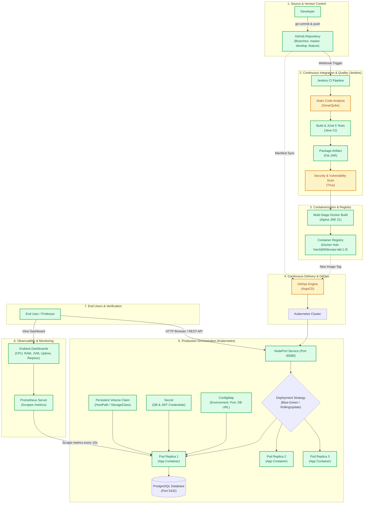
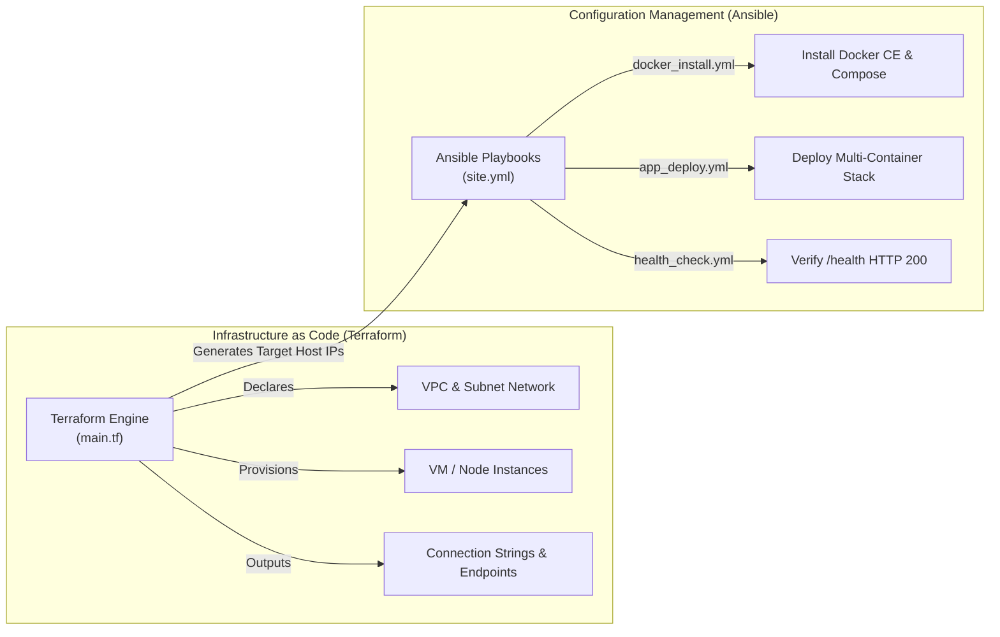
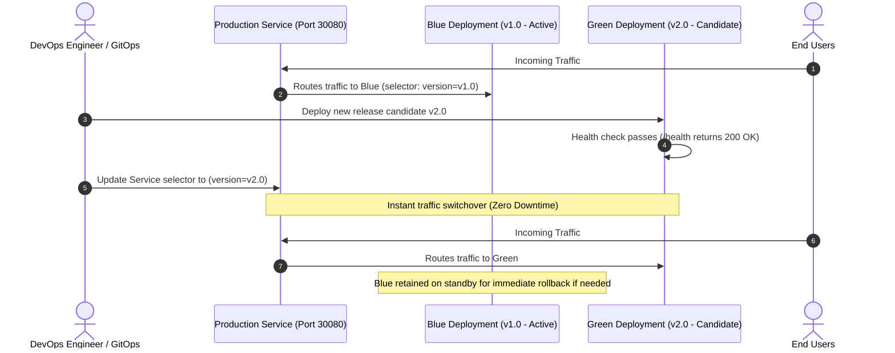

# Cloud-Native End-to-End DevOps Architecture

**Project Title:** Design and Implementation of an End-to-End DevOps Pipeline for Cloud-Native Application Deployment  
**Course Code:** ENSP461 — DevOps & Automation Lab  
**Author:** Harsh Jha  

---

## 1. High-Level System Architecture Diagram

---

## 2. Infrastructure as Code & Configuration Management

---

## 3. Blue-Green Zero-Downtime Deployment Flow

